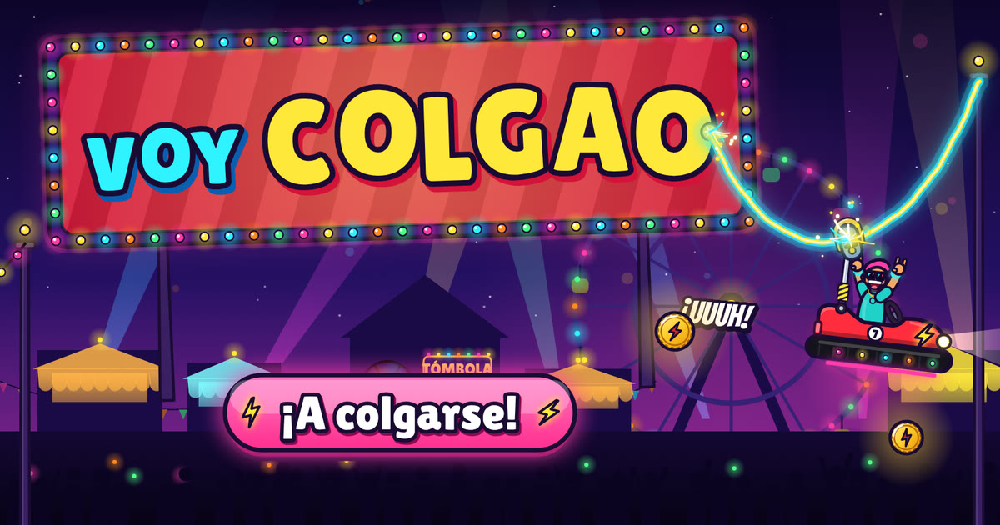

# Voy colgao

Juego de feria nocturna para el móvil en horizontal. Eres un coche de choque que cuelga de un cable eléctrico: el gancho de tu palo va encima del cable y el cable lo dibujas tú con el dedo. Detrás viene una marea de coches de choque que te quiere pillar.

**Jugar:** `/voycolgao` en camionesycaravanas.es (también responde en `/trazo`).

## Cómo se juega

- **Dibuja el cable** con el dedo (o el ratón) cerca del gancho. El coche rueda por encima: cuesta abajo gana velocidad, cuesta arriba la pierde.
- **El cable se gasta.** Coge fichas para tener más.
- **Mientras el gancho toca el cable hay corriente.** Si te quedas en el aire, se va la luz y la música se apaga; al volver a engancharte, vuelve la fiesta.
- **Pierdes** si te pilla la marea de coches («¡TOPETAZO!») o si caes al suelo («¡SIN CORRIENTE!»).
- Tus 10 mejores partidas se guardan en el navegador.
- Un feriante comenta la partida en un rótulo con bombillas.

| Tecla | Acción |
|---|---|
| `P` / `Esc` | Pausa / seguir |
| `R` | Reiniciar |
| `M` | Silencio |
| `F` | Pantalla completa |
| `D` | Panel de rendimiento (oculto) |

En iPhone, que no tiene pantalla completa para páginas web, usa Compartir → Añadir a pantalla de inicio.

## Desarrollo

Todo el juego es un solo `index.html`: un canvas, JavaScript sin dependencias ni paso de construcción, y sonido sintetizado con WebAudio (la música techno es un motor propio dentro del mismo fichero; no hay audios). Para probarlo basta servir esta carpeta con cualquier servidor estático. El texto está todo en el objeto `L` del principio del script (solo español). `og.jpg` sale del boceto aprobado de la pantalla de título.

## Origen

Es un fork de [mariomka/trazo](https://github.com/mariomka/trazo) («Trazo», un juego de tinta y papel), convertido en «Voy colgao». Basado en Trazo, de mariomka. Los cambios respecto al original están en `juegos/README.md`.
